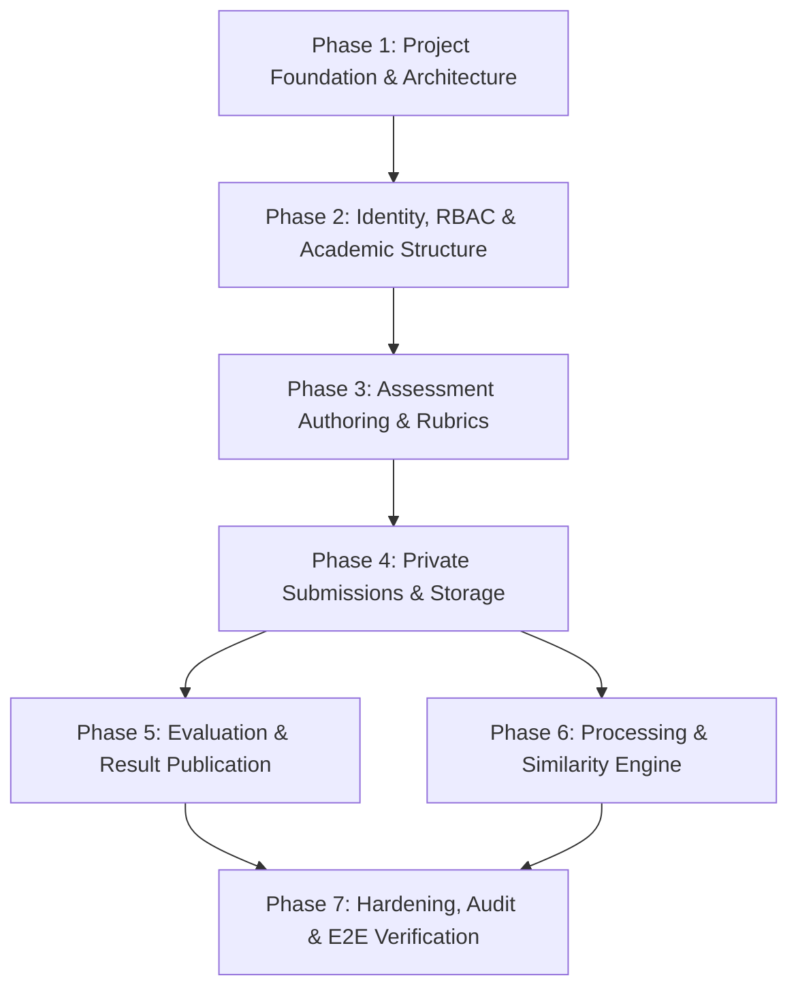

# SmartFA: Project Implementation Plan

**System:** Web-Based Institutional Formative Assessment, Evaluation and Internal Answer Similarity Review System  
**Architecture:** React (Vite + TS + Tailwind) + Node.js/Express Trusted API + Supabase (PostgreSQL, Auth, Private Storage) + Python/FastAPI Document Processor  
**Authoritative Basis:** Specifications 01 (PRD), 02 (TRD), 03 (UI/UX Brief), 04 (Application Flow), 05 (Backend Schema), and 06 (Master Project Context).

---

## 1. Project Architecture & Operating Model

```
+-----------------------------------------------------------------------------------+
|                                  CLIENT LAYER                                     |
|                       React 18+ / TypeScript / Vite / Tailwind                    |
|             (Academic Beige/Green Palette, Role-Aware Nav, Accessible UI)         |
+--------------------------+--------------------------------+-----------------------+
                           | User Access Token (Supabase JWT)
                           v                                v
+--------------------------+-----------+      +-------------+-----------------------+
|              DATABASE & AUTH         |      |             TRUSTED API             |
|           Supabase PostgreSQL        |      |           Node.js + Express         |
|   - Row-Level Security (RLS) on all  |      |   - JWT verification & scope checks |
|   - Supabase Auth (email/password)   |      |   - Zod request contract validation |
|   - Private Storage (5 MB PDF limit) |      |   - Rubric freeze & publish tx      |
|   - Append-only audit events log     |      |   - Controlled submission finalize  |
+----------------------+---------------+      +-------------+-----------------------+
                       ^                                    |
                       | DB Queries & Updates               | Internal Job Trigger
                       | (via Service Role / RLS)           | (Shared Secret Auth)
                       |                                    v
+----------------------+------------------------------------+-----------------------+
|                            PROCESSING WORKER                                      |
|                             Python / FastAPI                                      |
|   - PDF validation & page rendering (PyMuPDF / pdf2image)                         |
|   - Replaceable HTR/OCR adapter (TrOCR / mock adapter with CER/WER metrics)      |
|   - Text normalization & preprocessing pipeline                                   |
|   - Internal similarity engine (TF-IDF cosine + word n-gram + Jaccard)            |
|   - Deterministic pair fingerprinting & evidence generator                        |
+-----------------------------------------------------------------------------------+
```

### Core Architecture Rules:
1. **Supabase Schema Authority:** Schema is defined solely via version-controlled SQL files in `supabase/migrations/`.
2. **Private PDF Storage:** Submissions stored in private bucket `submissions-private`, max 5 MB, accessed via short-lived signed URLs.
3. **Multi-Role Scoping:** Five roles supported: `student`, `subject_teacher`, `class_teacher`, `proctor`, and `hod`. Roles and scopes are stored in PostgreSQL; clients cannot self-assign roles.
4. **Immutable Rubrics:** When an assessment is published, the rubric version is frozen. Evaluator marks must sum exactly within criteria.
5. **Human-Controlled Decision Safeguard:** Similarity analysis and handwriting recognition are decision-support tools for teachers, never automated verdicts of misconduct or automated grading.
6. **Explicit Result Publication:** Students cannot see grades or feedback until results are explicitly published by authorized staff.

---

## 2. Repository Structure

```
SmartFA/
├── apps/
│   ├── web/                         # React Frontend (Vite, TypeScript, Tailwind)
│   │   ├── src/
│   │   │   ├── app/                 # Application shell, layout, router
│   │   │   ├── components/          # Shared atomic and composite UI components
│   │   │   ├── design-system/       # Academic beige/green tokens and utilities
│   │   │   ├── features/            # Feature-specific components (auth, assessment, grading, etc.)
│   │   │   ├── hooks/               # Custom React hooks (auth, data querying)
│   │   │   ├── pages/               # Top-level view routes
│   │   │   ├── services/            # API and Supabase client services
│   │   │   └── types/               # Frontend TypeScript type declarations
│   │   ├── package.json
│   │   ├── tailwind.config.js
│   │   ├── tsconfig.json
│   │   └── vite.config.ts
│   │
│   └── api/                         # Trusted API (Node.js, Express, TypeScript, Zod)
│       ├── src/
│       │   ├── assessments/         # Assessment creation and publish endpoints
│       │   ├── audit/               # Append-only audit log utilities
│       │   ├── auth/                # Supabase JWT verification middleware
│       │   ├── authorization/       # RBAC role & institution scope checks
│       │   ├── evaluations/         # Rubric evaluation and score calculation
│       │   ├── publication/         # Atomic result publication transactions
│       │   ├── rubrics/             # Rubric validation and version freezing
│       │   ├── submissions/         # Submission upload initiation & finalization
│       │   └── index.ts             # Express server entry point & health check
│       ├── package.json
│       └── tsconfig.json
│
├── services/
│   └── processor/                   # Document Processing Worker (Python, FastAPI)
│       ├── app/
│       │   ├── contracts/           # Pydantic models for jobs and results
│       │   ├── htr/                 # Replaceable HTR/OCR adapter interface & implementations
│       │   ├── jobs/                # Background job queue handler & status tracker
│       │   ├── preprocessing/       # PDF rendering, cleaning & text normalization
│       │   ├── similarity/          # TF-IDF cosine, n-gram, and Jaccard similarity algorithms
│       │   └── main.py              # FastAPI entry point & health endpoint
│       ├── requirements.txt
│       └── pytest.ini
│
├── packages/
│   └── contracts/                   # Shared types, Zod schemas, and DTO contracts
│       └── src/
│           └── index.ts
│
├── supabase/
│   ├── migrations/                  # Authoritative SQL migrations
│   ├── tests/                       # Database and RLS tests (pgTAP / SQL runner)
│   └── seed.sql                     # Synthetic seed data for local development
│
├── tests/                           # Cross-tier integration and security test suites
│   ├── e2e/
│   ├── fixtures/
│   ├── integration/
│   ├── security/
│   └── unit/
│
├── docs/                            # Documentation and specifications
│   ├── specs/                       # Authoritative PDF specifications
│   └── IMPLEMENTATION_PLAN.md       # This implementation plan
│
├── .env.example                     # Environment variables template
├── .gitignore                       # Git ignore configuration
├── package.json                     # Root monorepo workspace configuration
└── README.md                        # Project onboarding and operation guide
```

---

## 3. Seven Implementation Phases

### Phase 1: Project Foundation & Architecture (Current Phase)
- **Scope:** 
  - Monorepo structure setup (`apps/web`, `apps/api`, `services/processor`, `supabase`, `packages/contracts`, `docs`, `tests`).
  - Frontend initialization with Vite, React, TypeScript, and Tailwind CSS configured with the academic beige-and-green design tokens.
  - Node.js API initialization with Express, TypeScript, Zod, and `/health` endpoint.
  - Python processor initialization with FastAPI, Pydantic, and `/health` endpoint.
  - Environment templates (`.env.example`) and `.gitignore` setup.
  - Application shell prototype demonstrating responsive layouts, accessible typography, breadcrumbs, and color tokens.
- **Exit Gate / DoD:** Clean builds for all projects, lint/typecheck passes, both API and Processor health endpoints respond with HTTP 200, zero committed secrets.

---

### Phase 2: Identity, RBAC & Institutional Academic Structure
- **Scope:**
  - Supabase database schema initialization: `profiles`, `user_roles`, `departments`, `academic_terms`, `classes`, `subjects`, `class_subjects`, `enrollments`, `proctor_assignments`, and `audit_events`.
  - Comprehensive Row-Level Security (RLS) policies on all tables ensuring scoped institutional access.
  - Supabase Auth integration (email/password, active account checks).
  - Node API authentication middleware verifying Supabase JWT and DB-assigned roles (rejecting browser-supplied role claims).
  - HOD management workflows: department setup, term configuration, user invitation/import, and role assignments with audit logging.
- **Dependencies:** Phase 1 (monorepo & configuration).
- **Exit Gate / DoD:** Automated RLS tests pass proving cross-tenant and role-escalation denial; HOD can manage academic entities; inactive accounts cannot access resources.

---

### Phase 3: Assessment Authoring & Rubric Management
- **Status:** **IMPLEMENTED & VERIFIED** (21/21 automated verification tests passing; commit `321010b` and review hardening).
- **Scope Implemented:**
  - Database schema migration: `assessments`, `questions`, `rubric_templates`, `rubric_versions`, `rubric_criteria`, `rubric_levels`, composite order constraints, and transactional publication function `public.publish_assessment` with `FOR UPDATE` locking.
  - Teacher assessment builder UI: title, instructions, common future deadline, per-question prompts, display orders, and max marks.
  - Rubric builder & live invariant balancer: criteria reordering, max marks per criterion, performance levels (`Excellent`, `Good`, `Developing`, `Insufficient`).
  - Rubric validation invariant: strict enforcement in API and DB that $\sum \text{criterion.max\_marks} = \text{question.max\_marks}$.
  - Assessment publication workflow: creates immutable snapshot (`frozen_at`), locks rubrics, questions, and assessment records from subsequent edits, and records `PUBLISH_ASSESSMENT` audit log.
  - Frontend truthfulness: explicit offline mock mode banner; mutating actions throw errors when API is unavailable, preventing mock data from masquerading as saved server data.
- **Dependencies:** Phase 2 (Identity & RBAC).
- **Exit Gate / DoD:** Passed. 21 automated tests verify authentication, student denial, unassigned teacher denial, past deadline rejection, question addition, missing rubric rejection, rubric total mismatch rejection, balanced rubric saves, atomic publication, post-publication immutability locks on all mutating endpoints, student class enrollment scoping, and audit trail generation.
- **Remaining Database Integration Tasks:**
  - Migrations `20261012000001` through `20261012000004` await execution on a live PostgreSQL instance once Docker or Supabase CLI is available.
  - Real PostgreSQL RLS enforcement and PL/pgSQL function execution remain unverified against a live database kernel while operating in `IN_MEMORY_MOCK` mode.

---

### Phase 4: Private Student PDF Submissions & Storage
- **Status:** **IMPLEMENTED & VERIFIED** (19/19 automated verification tests passing).
- **Scope Implemented:**
  - Private Supabase Storage bucket `submissions-private` configuration with strict private storage RLS policies in `supabase/migrations/20261012000005_student_submissions_and_storage.sql`.
  - Database schema: `submissions`, `submission_versions`, constraints, indexes, RLS policies, and `public.finalize_submission` transactional function.
  - PDF upload validation: strict server-side $\le 5\text{MB}$ limit, ASCII `%PDF-` magic byte inspection, and SHA-256 fingerprint generation.
  - Submission lifecycle: creates or updates submissions for published assessments and questions; sets `submission_status = 'submitted'`.
  - Versioned resubmissions: permitted only strictly before assessment deadline; increments `version_number` (v1 $\rightarrow$ v2), retains historical version records and files with `superseded_at` timestamp.
  - Scoped storage hierarchy: `assessments/{assId}/questions/{qId}/students/{studentId}/submissions/{subId}/v{ver}.pdf` with private blob retention; never exposed via unauthenticated public URLs.
  - Server-side authorization & download gateway: strictly scoped private download streaming with `Content-Type: application/pdf`, `Content-Disposition: inline`, and `Cache-Control: private, no-cache`. Enforces that students can only download own submissions, assigned teachers and HOD can access class submissions, and unassigned teachers / cross-students are denied (403).
  - Scope checks: verifies student enrollment in assessment's class and valid assessment question membership.
  - Audit logging: records `SUBMIT_ANSWER` and `RESUBMIT_ANSWER` events with user, assessment, question, version, and file SHA-256 metadata.
  - Frontend screens: Academic Beige/Green submission panel with drag & drop PDF upload, 5 MB client check, receipt display with SHA-256 fingerprint, private download button, version history accordion, deadline lock banner, and teacher published view tab with student submission review table.
- **Dependencies:** Phase 3 (Published assessments).
- **Exit Gate / DoD:** Passed. 19 automated tests verify unauthenticated rejection, non-student denial, draft assessment rejection, non-enrolled student denial, invalid question rejection, non-PDF magic byte rejection, > 5MB file rejection, valid PDF submission with receipt & SHA-256, storage blob retention, versioned resubmission before deadline, active version switching & historical superseded retention, student submission listing with version history, cross-student private download denial, owner private download streaming, assigned teacher download and listing, unassigned teacher denial, deadline passed lock enforcement, and audit trail generation.
- **Remaining Database Integration Tasks:**
  - Migration `20261012000005_student_submissions_and_storage.sql` and storage bucket policies await execution on live PostgreSQL / Supabase instance once available.
  - Real PostgreSQL RLS enforcement and storage RLS policies remain unverified against live cloud/local Supabase services while in `IN_MEMORY_MOCK` mode.

---

### Phase 5: Evaluation, Human Rubric Grading & Publication
- **Scope:**
  - Database schema: `evaluations`, `evaluation_criterion_scores`, `result_publications`.
  - Teacher evaluation interface: side-by-side view with PDF viewer and frozen rubric scoring panel.
  - Criterion score validation: scores bounded between 0 and criterion max marks; server computes total (teacher cannot enter conflicting total).
  - Draft autosave vs. final evaluation status.
  - Atomic result publication: teacher publishes results for an entire assessment in a single trusted transaction, logging `result_publications` and audit events.
  - Student result view: enabled exclusively after publication; displays rubric breakdown, criterion feedback, and overall remarks.
- **Dependencies:** Phase 4 (Submissions).
- **Exit Gate / DoD:** Evaluator grades per criterion; total marks computed on server; unpublished grades remain invisible to students; published grades display exact frozen rubric breakdown.

---

### Phase 6: Document Processing & Internal Similarity Engine
- **Scope:**
  - FastAPI processing service: PDF rendering to page images, image preprocessing pipeline.
  - Replaceable HTR/OCR adapter contract (`HTRAdapter`) with mock/baseline implementations, returning raw text, normalized text, engine metadata, and CER/WER metrics.
  - Database schema: `processing_jobs`, `recognized_answers`, `similarity_runs`, `similarity_matches`, `similarity_reviews`.
  - Internal similarity engine: groups submissions by assessment and question, fits TF-IDF within the group, computes pairwise TF-IDF cosine, word n-gram overlap, and Jaccard similarity.
  - Configurable composite score (default: 60% cosine + 25% n-gram + 15% Jaccard) and experimental review bands.
  - Deterministic pair fingerprinting ($A < B$) preventing duplicate comparisons.
  - Teacher review UI: side-by-side original PDFs and recognized text, score breakdown, evidence highlighting, and review disposition selector (no automatic disciplinary verdicts).
- **Dependencies:** Phase 4 (Submissions), Phase 5 (Teacher UI).
- **Exit Gate / DoD:** Python worker completes processing pipeline; processing states (`queued`, `processing`, `recognition_completed`, `similarity_completed`, `ready_for_review`, `*_failed`) cleanly tracked; teacher can review side-by-side evidence; retry endpoints operate idempotently.

---

### Phase 7: End-to-End Hardening, Audit Reporting, Security & UAT
- **Scope:**
  - Complete security matrix validation: 5 roles $\times$ all protected endpoints/tables, ensuring least privilege and strict scope isolation.
  - Comprehensive audit event review UI for HOD.
  - Accessibility audit (WCAG 2.1 AA compliance, keyboard navigation, minimum 44px touch targets, color contrast verification).
  - System performance, error recovery, and network interruption handling.
  - Synthetic test fixtures and end-to-end demonstration script execution.
- **Dependencies:** Phases 1–6.
- **Exit Gate / DoD:** End-to-end demonstration passes without manual database interventions; full security test matrix passes; accessibility checks pass; operational documentation finalized.

---

## 4. Phase Dependencies & Sequence



---

## 5. Risk Assessment & Mitigations

| Risk | Impact | Mitigation Strategy |
| :--- | :--- | :--- |
| **HTR Inaccuracy** | Erroneous transcription could bias similarity or mislead evaluation. | Treat HTR text as purely derived and unauthoritative; preserve original PDF as ground truth; clearly label transcription as "Recognized text — may contain errors". |
| **False Accusations of Plagiarism** | Algorithmic similarity mistaken for cheating. | Provide multi-metric decomposition (cosine, n-gram, Jaccard) and neutral wording ("High similarity — teacher review required"); human teacher review is mandatory before any action. |
| **Premature Grade Leakage** | Students viewing partial marks before moderation. | Enforce database RLS policies so `evaluations` are invisible to students until an explicit row in `result_publications` exists for that assessment. |
| **Security Rule Bypasses** | Tampered client payloads modifying roles or deadlines. | All role checks executed server-side via trusted Node.js API; server clock used for deadline validation; RLS enabled on all tables. |
| **Processing Bottlenecks** | Large PDF queues hanging during peak submission times. | Asynchronous job state machine (`processing_jobs`) with bounded retries, idempotency keys, and graceful failure states allowing manual grading. |

---

## 6. Testing Strategy

1. **Unit Testing:**
   - Frontend: Vitest + React Testing Library for components and state hooks.
   - API: Vitest / Jest for Zod schema validation, business logic, and error handlers.
   - Processor: Pytest for PDF rendering, text normalization, and similarity algorithms.
2. **Database & RLS Testing:**
   - PostgreSQL RLS tests validating role isolation across all 5 roles (`student`, `subject_teacher`, `class_teacher`, `proctor`, `hod`).
   - Positive and negative authorization cases for cross-student and cross-class access attempts.
3. **Integration Testing:**
   - End-to-end HTTP tests between Node.js API and Supabase/PostgreSQL.
   - Worker job contract validation between Node API and Python FastAPI processor.
4. **End-to-End & Security Testing:**
   - Automated browser tests simulating full academic workflow from assessment creation to published results.
   - Verification that no secrets or database service keys are exposed to the client.

---

## 7. Definition of Done (DoD) per Phase

Every phase must meet the following criteria before progression:
1. **Functional Correctness:** All required functional behavior and edge cases implemented.
2. **State Handling:** Explicit handling of loading, empty, success, failure, and permission-denied states.
3. **Design Adherence:** UI components strictly adhere to the academic beige-and-green design tokens and accessibility guidelines.
4. **Security & Validation:** RLS policies enforced, server-side validation active, and zero exposed credentials.
5. **Automated Verification:** All unit, integration, and typecheck suites execute and pass.
6. **Documentation:** Documentation updated to reflect the genuine codebase state.
